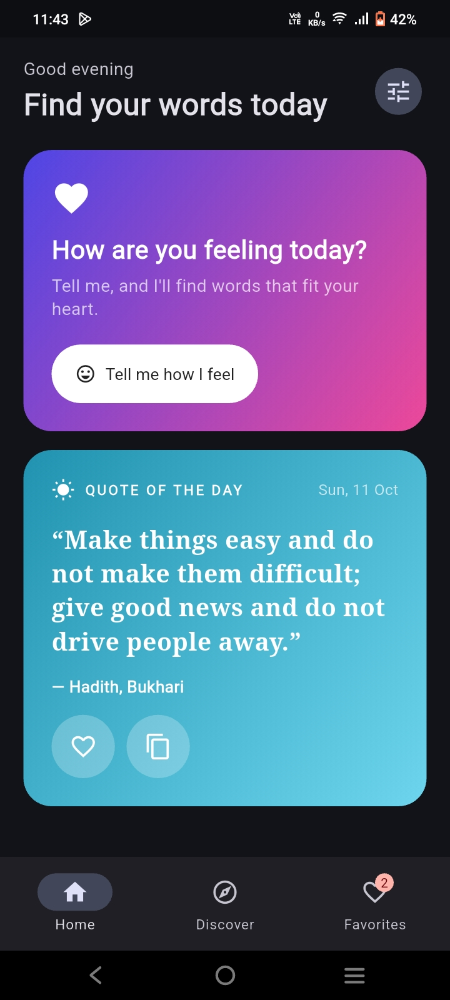

# Quote Generator

A Flutter app that serves up quotes for how you feel: pick a mood and get something to cheer you up, browse 10 categories, read Quran verses, and see a new quote every day.

Built for the **CodeAlpha App Development Internship, Task 2**.



## Features
- **Mood-based quotes:** choose how you feel and get a matching cheer-up quote
- **Daily quote:** a fresh quote each day on the home screen
- **10 categories:** browse quotes by topic
- **Quran verses:** a dedicated section for verses
- **Favorites:** save quotes you like and come back to them (stored on the device)
- **Dark mode:** switch between light and dark themes
- **Runs on phone and desktop:** one codebase for Android, iOS, web, Windows, macOS and Linux

## Tech stack
| Part | Choice |
|------|--------|
| Framework | Flutter (Dart SDK ^3.10.7) |
| Local storage | `shared_preferences` |
| Icons and splash | `flutter_launcher_icons`, `flutter_native_splash` |

## Getting started

### Prerequisites
- [Flutter SDK](https://docs.flutter.dev/get-started/install) installed (run `flutter doctor` to check)
- An emulator, a connected phone, or Chrome / a desktop target

### Run it
```bash
git clone https://github.com/Rohma05/CodeAlpha_QuoteGenerator.git
cd CodeAlpha_QuoteGenerator
flutter pub get
flutter run
```

To choose a platform: `flutter run -d chrome`, `flutter run -d windows`, or pick a device from `flutter devices`.

### Build
```bash
flutter build apk      # Android
flutter build web      # Web
```

## Project structure
```
lib/       app source code (screens, data, logic)
assets/    images, icon and splash artwork
test/      tests
android/ ios/ web/ windows/ macos/ linux/   platform folders
```

## Roadmap
- [ ] Share a quote as text or image
- [ ] Notification for the daily quote
- [ ] Search across all quotes

## About
Made by **Rohma** as part of the CodeAlpha internship program.
GitHub: [@Rohma05](https://github.com/Rohma05)
